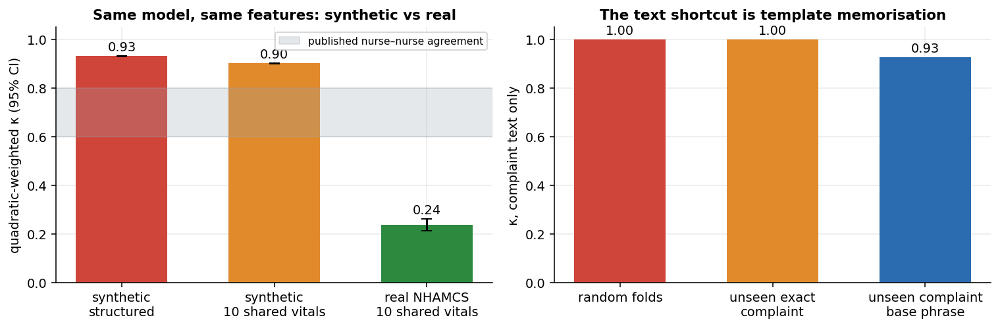
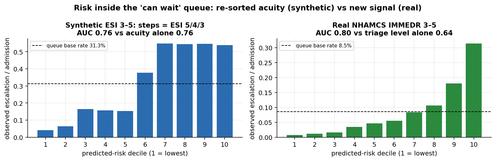
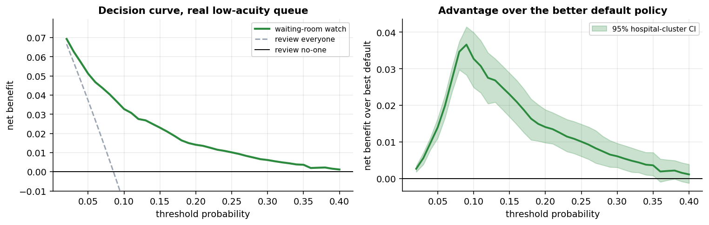

# Triagegeist — The Waiting-Room Blind Spot

Submission for the **Triagegeist: AI in Emergency Triage** competition
(Laitinen-Fredriksson Foundation). Full write-up: [`writeup.md`](writeup.md).

A triage acuity level answers *"how sick is this patient now?"*, not *"who in
the waiting room will end up needing a bed?"* This project:

1. **Tests whether the competition's synthetic benchmark can judge triage AI.**
   It cannot: the labels show no rater effect across 50 nurses (Cramér's V 0.02
   vs 0.35 across real hospitals), the vitals encode the label, and the same
   model on the same 10 vitals scores κ 0.90 on synthetic triage but 0.24 on
   real triage.
2. **Validates a second-read "waiting-room watch" on real CDC data (NHAMCS).**
   Among real patients triaged as lower acuity, triage-time data predicts
   admission at AUC 0.80 versus 0.64 for the triage level alone
   (hospital-grouped validation, +0.156 [0.131, 0.182]). Flagging the top 20%
   catches 58% of later admissions at 2.9× the base rate, with positive net
   benefit for thresholds from 2% to 35%.

Every number in the write-up comes from `artifacts/results.json`, with 95%
bootstrap intervals (hospital-clustered on NHAMCS).





## Reproduce

```bash
pip install -r requirements.txt

# 1. Competition data -> comp_data/
kaggle competitions download -c triagegeist -p comp_data
unzip comp_data/triagegeist.zip -d comp_data

# 2. Real ED data (downloads the CDC public-use files if data/ed2021, data/ed2022 are absent)
python src/load_nhamcs.py          # -> data/nhamcs_ed_clean.parquet

# 3. Analysis, figures, notebook
python src/analysis.py             # ~35 min on a laptop CPU -> artifacts/results.json
python src/figures.py              # -> artifacts/fig_*.png
python src/build_notebook.py       # -> notebook/triagegeist.ipynb
```

## Layout

```
src/stats.py          bootstrap (patient or hospital-cluster), cross-fitted calibration,
                      operating points, decision curves, Holm correction
src/load_nhamcs.py    parse the NHAMCS fixed-width ED files with codebook byte positions
src/analysis.py       five modules: generator forensics, acuity, equity, synthetic watch,
                      NHAMCS validation -> artifacts/results.json
src/figures.py        figures drawn only from results.json and saved predictions
src/build_notebook.py builds the Kaggle notebook from the modules above
src/make_cover.py     560x280 cover image
data/                 codebook layouts and NHAMCS readme (raw files are downloaded)
notebook/             Kaggle notebook
```

## Data sources

- **Triagegeist synthetic ED dataset**, via the Kaggle competition, used under
  competition terms.
- **NHAMCS** ED public-use files 2021–2022, CDC/NCHS, public domain.
  https://www.cdc.gov/nchs/ahcd/

No credentials are committed. Kaggle tokens are git-ignored.
